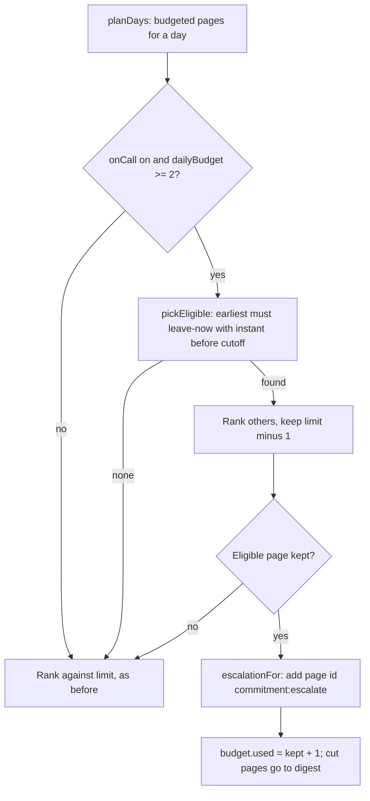
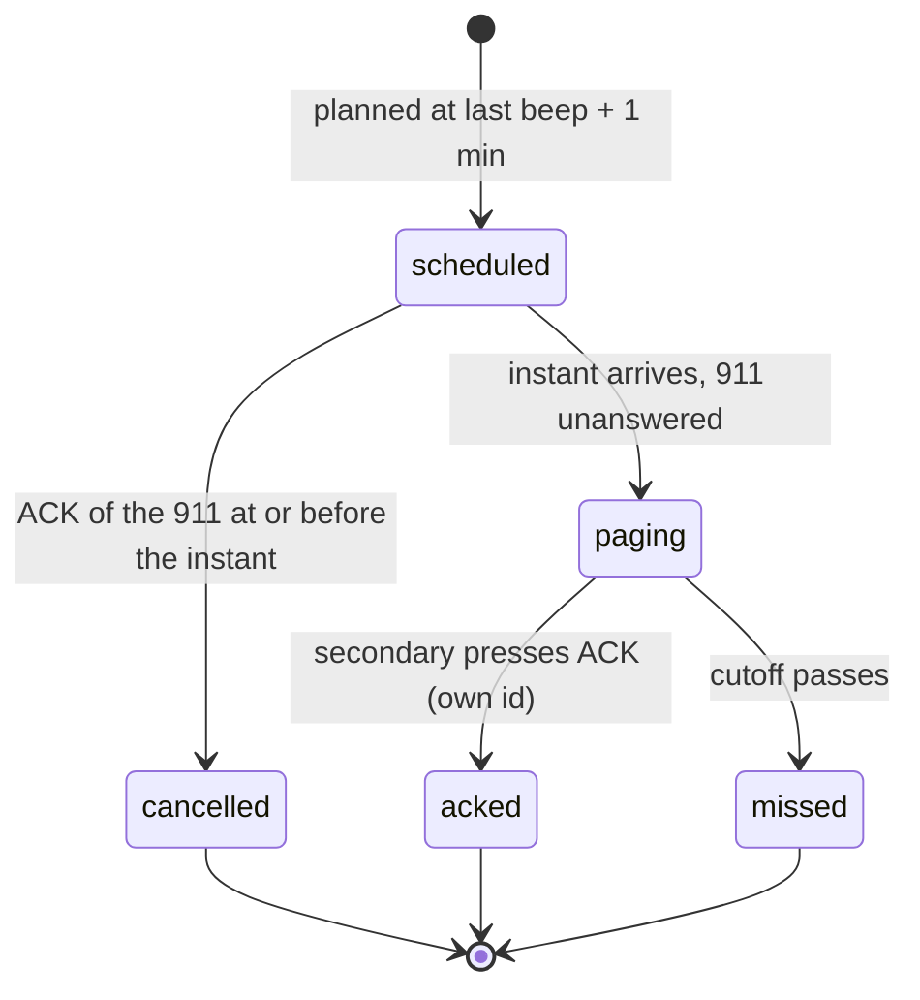

# Design: On-call escalation to a secondary

## Overview
The user may name a secondary on call. When a must-priority leave-now (911) page is still unacknowledged after its last repeat, Revenant pages the secondary on a second on-screen pager labelled "SECONDARY ON CALL". The feature is off by default and on-screen only: no SMS, no network call, nothing leaves the device.

The design adds one kind of page, `escalation`, and lets the existing engine carry it. An escalation page is an ordinary `PlannedPage` with a fixed fire time, its own id, its own ACK and its own delivered state, so `tick`, `acknowledge`, `rewind`, `pinnedPageIds` and `ignoreReplay` work unchanged. Three things are new: the planner reserves a budget slot for it, an ACK of the leave-now page cancels it, and the app shows it on a second pager instead of the user's own.

The plan is a pure function of commitments, settings and pinned page ids. An ACK does not change the plan; it only cancels the escalation at read time, so the plan stays deterministic and a re-plan never moves a page.

### Decision: how the budget makes room
Options considered:

| Option | What happens | Why not, or why |
|---|---|---|
| A. Claim a slot only if the day has one spare | After normal ranking, an escalation is granted only if `used < limit` | Never displaces a primary page. But the sample day already uses 6 of 6, and a busy day always does, so the feature would silently never fire on the days it matters. Rejected. |
| B. Make the escalation a ranked candidate | The escalation page competes in the normal ranking | Rank is by priority, kind and time. An escalation has no natural place: ranked high it can push out the very 911 it backs up, ranked low it is the first thing cut. Rejected. |
| **C. Reserve a slot before ranking, decided at plan time** | The planner picks the one eligible page of the day, sets one slot aside, ranks the other pages against `limit - 1`, and drops the reservation if the eligible page does not fit | Chosen. |

Why C. It is deterministic and does not depend on ACKs: the plan is the same whether or not the user answers, so budget meter, digest and pinning stay stable. The guarantee is explicit, so the day sheet can say where the slot went. The cost is that a day with a reservation has one fewer slot for ordinary pages, and the page that loses it goes to the digest like any other over-budget page (Req 5.6). That follows the product rule "fewer pages beat more pages": the escalation replaces the lowest-ranked page of the day, and the daily budget still holds. Three limits keep the cost small: one escalation per day (Req 2.4), no reservation when the budget is below 2 (Req 5.4), and the reservation is released when its eligible page does not fit (Req 5.5).

A reserved slot that is never used (the user answers in time) is not handed back, because the plan must not depend on ACKs. The receipt counts only beeps that happened, so the user is not told they were paged.

### Why one minute after the last beep
The user asked for escalation "after its last repeat". With the default offsets 3, 6 and 10 minutes, the last beep is 10 minutes after the first. One extra minute (`ESCALATION_GRACE_MIN`) gives the user a full minute to answer the last repeat before a second person is involved, and it is a fixed constant so tests and the demo are predictable. When a leave-now page has no repeats before its cutoff (a video call with a 2-minute lead), the last beep is the first beep.

## Components and files
| Component | File | Change |
|---|---|---|
| Escalation rules (new, pure) | `src/engine/escalate.ts` | Eligibility, escalation instant, message, name validation, cancellation, status |
| Types | `src/engine/types.ts` | `OnCallSettings`, `Settings.onCall?`, `PageKind` gains `'escalation'`, `PlannedPage` gains `dependsOn?` and `secondaryName?` |
| Codes | `src/engine/codes.ts` | `CODE_FOR.escalation = '999'`, a `CODE_CARD` row, `SECONDARY_LABEL` |
| Planner | `src/engine/plan.ts` | Reserve a slot, rank against `limit - reserved`, add the escalation page, count it in `budget.used` |
| Alerts | `src/engine/alerts.ts` | `alertsUpTo` and `nextAlertAt` skip cancelled pages |
| Runtime | `src/engine/runtime.ts` | `activePages` unchanged; the split by pager happens in `escalate.ts` |
| Replay | `src/engine/haunt.ts` | `pickIgnoreTarget` and `ignoreReplay` leave escalation pages alone; `rebookPage` skips them |
| Receipt and recap | `src/engine/report.ts` | `escalated` count, escalation pages out of `missed`, `dayReportLine` mentions the secondary, `haunting` skips them |
| Sample | `src/engine/sample.ts` | `SAMPLE_ON_CALL` (`{ enabled: true, name: 'Sam' }`) for the demo and tests; `defaultSettings` stays off |
| Storage (Session B) | `src/adapters/storage.ts` | `isSnapshot` accepts a missing or malformed `onCall`, `readOnCall` cleans it |
| Relay sync (Session B) | `src/adapters/schedule-sync.ts`, `channel.ts` | Skip escalation pages and alerts |
| Hook (Session B) | `src/app/usePager.ts` | Split active pages by pager, `ackSecondary`, announcement, replay wiring, save and load |
| Components (Session B) | `SecondaryPager.tsx` (new), `Pager.tsx`, `SettingsPanel.tsx`, `DaySheet.tsx`, `CodeCard.tsx`, `App.tsx` (key S), `styles.css`, `beep.ts` | Second pager, form, day sheet row and receipt line |

`escalate.ts` imports only `types`, `codes` and `time`, and `plan.ts` imports `escalate.ts`, so there is no import cycle.

## Data models
```ts
// types.ts
export interface OnCallSettings {
  enabled: boolean;
  /** The secondary's name as typed: trimmed, 1-24 characters, no control characters. */
  name: string;
}
export interface Settings { /* existing fields */ onCall?: OnCallSettings }   // absent = off

export type PageKind = 'get-ready' | 'leave-now' | 'focus-start' | 'check-in' | 'wrap-up' | 'digest' | 'escalation';

export interface PlannedPage {
  /* existing fields */
  /** Escalation pages only: the leave-now page that, if acknowledged at or before this page's fireAt, cancels it. */
  dependsOn?: string;
  /** Escalation pages only: the secondary's name, for the day sheet and the receipt. */
  secondaryName?: string;
}

// escalate.ts
export type EscalationStatus = PageStatus | 'cancelled';          // PageStatus itself is unchanged
export const ESCALATION_GRACE_MIN = 1;
export const MAX_SECONDARY_NAME = 24;
export const MAX_ESCALATION_TEXT = 120;
export const MAX_ESCALATIONS_PER_DAY = 1;
export type NameCheck = { ok: true; name: string } | { ok: false; reason: 'empty' | 'too-long' | 'control-characters' };

export function normalizeSecondaryName(raw: string): NameCheck;
export function readOnCall(value: unknown): OnCallSettings | null;                    // null = treat as off
export function onCallName(settings: Settings): string | null;                        // name when enabled and valid
export function isEscalation(p: PlannedPage): boolean;
export function escalationId(leaveNow: PlannedPage): string;                          // `${commitmentId}:escalate`
export function lastBeepAt(p: PlannedPage): number;
export function escalationInstant(p: PlannedPage): number;                            // lastBeepAt + 1 min
export function isEligible(p: PlannedPage, c: Commitment | undefined): boolean;       // leave-now of a must commitment
export function pickEligible(day: PlannedPage[], commitments: Map<string, Commitment>, settings: Settings, pinned: Set<string>): PlannedPage | null;
export function escalationText(name: string, p: PlannedPage, c: Commitment, timeZone: string): string;
export function escalationFor(p: PlannedPage, c: Commitment, name: string, timeZone: string): PlannedPage | null;  // null when instant >= cutoff
export function isCancelled(p: PlannedPage, acks: Acks): boolean;                    // acks[dependsOn] <= p.fireAt
export function escalationStatus(p: PlannedPage, acks: Acks, now: number): EscalationStatus;
export function splitByPager(pages: readonly PlannedPage[]): { primary: PlannedPage[]; secondary: PlannedPage[] };

// DayReport (report.ts) gains
escalated: number;            // escalation pages that were not cancelled
secondaryName: string | null; // from the escalation page
```
The stored snapshot keeps its `version: 1`. `settings.onCall` is optional, so snapshots saved earlier load with escalation off (Req 9.3).

`PageStatus` is not widened. A `'cancelled'` status exists only as `EscalationStatus`, returned by `escalationStatus`. This keeps every exhaustive `Record<PageStatus, ...>` in the app compiling during Session A; the day sheet switches to `escalationStatus` in Session B.

## Algorithm
### Planning (`planDays`)
For each local day with budgeted pages, after the existing candidate step:

1. If `onCallName(settings)` is null or `dailyBudget < 2`, do nothing different. The plan equals the plan without the feature (Req 2.6, 5.4).
2. `pickEligible` filters the day's budgeted leave-now pages of `must` commitments whose escalation instant is before their cutoff (Req 2.5), puts a page whose escalation was already delivered first (so a beeped escalation keeps its slot, Req 5.7), then orders by `fireAt` and id and takes the first (Req 2.4).
3. With a candidate, rank the day's pages as before but keep `limit - 1` of them. If the candidate is among the kept pages, build its escalation page with `escalationFor` and add it to the day. Otherwise discard the reservation and keep `limit` pages as before (Req 5.5).
4. `budget.used` = kept pages + 1 when an escalation was added (Req 5.8). Pages ranked out go to the digest as `over-budget` (Req 5.6).
5. The escalation page takes the day key of its leave-now page, so its slot is counted on the day it reserved.

The escalation page: `id = <commitment>:escalate`, `kind = 'escalation'`, `code = '999'`, `fireAt = escalationInstant`, `escalateAt = []`, `cutoffAt = leave-now cutoff`, `silent = false`, `countsToBudget = true`, `priority = 'must'`, `dependsOn = <commitment>:leave-now`.

Message: `${NAME}: OWNER MISSED 911, ${VERB} FOR ${TITLE}. STARTS ${LCD CLOCK}`. If longer than 120 characters the title is cut with an ellipsis (Req 4.3).

### Reading (`alerts.ts`, `escalate.ts`)
`isCancelled(p, acks)` is true when `p.dependsOn` is set and `acks[p.dependsOn]` exists and is `<= p.fireAt`. An ACK at the very instant counts as an answer, the same rule the repeats use. `alertsUpTo` and `nextAlertAt` skip cancelled pages, so no alert of a cancelled escalation exists. Because cancellation is derived from the ACK timestamp, `rewind` and `tick` need no change: an ACK at 10:16 cancels the escalation however late the app reads it, and an ACK at 10:25 does not bring it back.

### Replay (`haunt.ts`)
`pickIgnoreTarget` skips pages of kind `escalation`. `ignoreReplay` acknowledges every other page except escalation pages at its first beep; the answered leave-now pages cancel their own escalation pages, while the target's escalation page stays unanswered and is part of `delivered` up to `dayOverAt`. The escalation instant is before the target's cutoff, and the 666 recap appears at the latest cutoff, so the order is repeats, then secondary pager, then 666 (Req 8.2).

### Worked example on the sample day
Assumptions: America/Chicago, settings from `defaultSettings` (budget 6, buffer 5, honesty 1.5, repeats at 3, 6 and 10 minutes), `SAMPLE_ON_CALL` with the name "Sam", and the home to dentist estimate of 16 minutes (4.7 km straight line, times 1.3, at 35 km/h plus 6 minutes overhead; the unit test pins the exact value from `travel.ts`).

Without the feature the day has seven budgeted candidates and keeps six: dentist 911, pickup 911, dentist 411, stand-up (JOIN), dinner 911, taxes 121. Dinner 411 goes to the digest.

With the feature on:
1. Eligible pages (`must` leave-now): dentist 911 at 10:09 and school pickup 911 at about 14:58. The dentist fires first, so it is the day's one candidate.
2. Reserve one slot. Rank the rest against five: dentist 911, pickup 911, dentist 411 (all must), then stand-up 911 and dinner 911 (normal, leave-now first). The dentist 911 is kept, so the reservation stands.
3. Taxes 121 and dinner 411 now go to the digest as over-budget. `budget.used` = 5 + 1 = 6 of 6.
4. Dentist 911: start 10:30, leave 10:09, repeats 10:12, 10:15, 10:19. Last beep 10:19, escalation instant 10:20, cutoff 10:30.
5. Page `sample-dentist:escalate`, code 999: `SAM: OWNER MISSED 911, LEAVE FOR DENTIST CLEANING. STARTS 10:30A`.

Timeline if the user ignores it: 10:09 911, 10:12 911 911, 10:15 911 911 911, 10:19 911 911 911, 10:20 secondary pager 999, 10:30 cutoff, then the 666 recap. If the user presses ACK at 10:16, `acks['sample-dentist:leave-now'] = 10:16 <= 10:20`, so the escalation is cancelled. If they press ACK at 10:25, Sam was already paged and stays paged.

## Diagrams




## Error handling
- Name refused (empty, longer than 24 characters, control characters): escalation stays off, the field is marked invalid and the message is tied to it. The previous saved name is kept.
- Stored `onCall` malformed or from a newer shape: `readOnCall` returns null, escalation is off, the rest of the snapshot loads.
- Storage blocked or full: the pager keeps working in memory, as today.
- Escalation instant not before the cutoff: no escalation page, no reservation (Req 2.5).
- Budget below 2, or the eligible page does not fit: no escalation page, no reservation.
- Turning escalation off while an escalation page is showing: the page leaves the plan and the secondary pager returns to its idle state; nothing is sent anywhere, so nothing needs to be withdrawn.
- App closed past the cutoff: the escalation page is stale and never beeps (the existing rule).
- A relay channel is selected: escalation pages and alerts are filtered out before the schedule diff and the channel, so no network call is made.

## Correctness properties
Checked in `tests/unit/properties.test.ts` (or a new `tests/unit/escalate.properties.test.ts`) with fast-check, against the same generated days as the existing properties, with `onCall` on.

| Property | Criteria |
|---|---|
| **Escalation never makes a day exceed the budget.** For any generated day and `dailyBudget`, the non-silent, budget-counted pages of each local day, escalation pages included, number at most `dailyBudget`, and `budget.used` equals that number. | 5.1, 5.3, 5.8 |
| **An ACK before the escalation instant means no escalation.** For any eligible page and any ACK time at or before its escalation instant, `alertsUpTo` returns no alert for the escalation page and `escalationStatus` is `cancelled`. | 6.1, 6.2 |
| **An ACK after the instant changes nothing.** For any ACK time after the instant (and before the cutoff), the escalation page's alerts are the same as with no ACK. | 6.3 |
| **Escalation is deterministic.** The same input gives the same plan, in the same order, whatever order the commitments arrive in. | 12.1, 12.2 |
| **Off means unchanged.** With `onCall` absent or disabled, the plan equals the plan of the same input with the field removed, and no page has kind `escalation`. | 1.1, 1.7, 2.6 |
| **Only the right page escalates, at the right time.** Every escalation page depends on a leave-now page of a `must` commitment, there is at most one per local day, it fires one minute after that page's last beep, and it fires strictly before the cutoff. | 2.1-2.5, 3.1, 3.4, 3.5 |
| **Escalation never reaches the 666 recap.** For any acknowledgement pattern, `haunting`, `rebookPage` and `pickIgnoreTarget` never name an escalation page. | 7.4, 7.6, 8.1 |
| **The secondary's ACK is independent.** Acknowledging an escalation page does not change the status of its leave-now page, and the reverse. | 6.4-6.6 |

## Testing strategy
- Properties (fast-check): the eight above.
- Unit (Vitest, `tests/unit/escalate.test.ts`): name validation (trim, collapse, empty, 25 characters, control characters, 24 characters accepted), `readOnCall` on malformed values, eligibility per kind and priority, the instant with and without repeats, the instant across a daylight-saving change, message text for LEAVE and JOIN and a long title, planner reservation (budget 6 sample day, budget 1, eligible page that does not fit, pinned escalation), cancellation at and after the instant, delivered once, stale after cutoff, rewind, replay order, receipt and recap exclusions, and the code card row.
- Regression: the existing plan, report and haunt tests pass unchanged with `onCall` absent.
- Traceability: `tests/unit/traceability.test.ts` checks every folder under `.kiro/specs`.
- Purity: `tests/unit/purity.test.ts` scans the new engine file.
- End to end (Playwright, production build, Chromium desktop and phone): turn it on with a name and see validation messages; reload keeps it; jump to the dentist 911 on the sample day and see the secondary pager at 10:20 with the right text; ACK on the secondary pager by button and key S; ACK of the 911 at 10:16 cancels it; day sheet row and receipt line; the replay shows 911s, then the secondary pager, then 666; axe-core scan with the secondary pager paging; reduced motion; no network request while the escalation beeps.

## Out of scope: delivery to a real person
Sending the escalation through the relay (an SMS to the secondary's own number through Amazon End User Messaging, scheduled with EventBridge Scheduler) is a follow-up. It needs the secondary's consent and number, an opt-out path, a per-number daily cap in the relay's ledger and a threat-model row in the relay design, because it is the first feature that would text someone other than the user. Nothing in this pass sends, stores or asks for a phone number.

## Open questions
1. **The owner's name in the message.** The message says "OWNER MISSED 911" because the app does not know the user's name. Recommended default: keep "OWNER" in this pass, and add an optional "Your name" field in the follow-up that delivers to a real person, where the secondary needs to know who is asking.
2. **One escalation per day.** A day with two must leave-now pages escalates only the first. Recommended default: keep one, since each extra reservation costs a primary page. Revisit if the budget default rises.
3. **Reserved slot never refunded.** If the user answers in time, the slot is unused, and the page it displaced stays in the digest. Recommended default: accept it, because refunding would make the plan depend on ACKs.
4. **Escalate priority normal?** Only `must` escalates. Recommended default: keep `must` only; "normal" would double the reservations.
5. **Secondary pager sound.** The secondary pager chirps once at a lower pitch, so a shared screen is distinguishable. Recommended default: yes, and it follows MUTE.
6. **Key S.** S acknowledges the secondary pager. Recommended default: S, because A is taken and the key does not clash with R, M and N.
