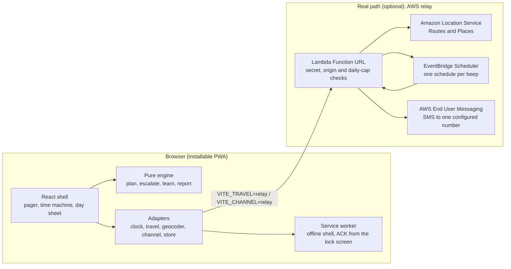

# Revenant

**The 1990s pager, back from the dead for ADHD brains. It stays silent all day and goes off only at the moment you have to act.**

<!-- Hero GIF: docs/media/demo.gif (the one-press demo: 411, 911, 911 911, ACK). -->

**Live app** · **Demo video** · **Devpost**: links are added when the entry is submitted. Until then: `npm ci && npm run dev`.

**Try it in 60 seconds.** Press **Watch a day in about a minute**, then press **ACK** (or `A`) each time the pager stops on a page. The day ends on a receipt: *"That was your day: 6 beeps, 4 kept quiet in the digest, 0 missed."*

- **Pages at the action, not the start.** `411` when it is time to get ready, `911` when it is time to walk out the door, worked out from travel time, a buffer and an honest prep time.
- **Six beeps a day, not fifty-six.** A hard daily budget. Everything else goes into one silent `100` digest.
- **Repeats until you ACK.** `911 911`, then `NOW!!`, and it learns from the pages you answer late.

**Kiroween 2026, category Resurrection.** *What died:* the pager, a device that was trusted because it was almost always silent. *What came back:* its behaviour, not just its look: numeric codes, a strict silence budget, repeats until ACK, and pages you ignore coming back to haunt you as `666`.

## One morning, before and after
Maya, 34, is an illustrative persona, not a real user. Dentist at 10:30 AM, 22 minutes away; she says getting ready takes 20 minutes. The times below are computed by the engine (`src/engine/compare.ts`, checked in `tests/unit/compare.test.ts`) and shown in the app above the day sheet.

| | What fires | What happens |
|---|---|---|
| **Her phone** | 10:15 AM "Dentist in 15 min" | Getting ready really takes 30 min, so she is out the door at 10:45 and **37 min late**. |
| **Revenant** | 9:33 AM `411` get ready, 10:03 AM `911` leave now | She arrives at 10:25, **5 min early**, after two beeps. |

## Why a pager? It worked before
In the 1990s, the NeuroPage trial gave people with memory and planning problems a pager that sent short reminders at the moment to act. In a randomised crossover study of 143 people aged 8 to 83, more than 80% of those who completed the 16 weeks were significantly better at everyday tasks such as taking medication and keeping appointments with the pager, and most kept the gain 7 weeks after handing it back ([Wilson et al., *J Neurol Neurosurg Psychiatry* 70(4), 2001](https://doi.org/10.1136/jnnp.70.4.477)). That trial's participants were mostly people with brain injuries, not ADHD; Revenant borrows the mechanism, not the result. Many hospital teams still carry pagers today: a dedicated device that rarely goes off is hard to ignore.

We didn't invent this. Phones buried it under a median of 56 notifications a day ([Pielot et al., MobileHCI 2018](https://doi.org/10.1145/3229434.3229445)). We dug it up.

**Why it matters**
- About 15.5 million US adults, 1 in 16, have a current ADHD diagnosis, and more than half were diagnosed as adults ([CDC, *MMWR* 73(40), 2024](https://www.cdc.gov/mmwr/volumes/73/wr/mm7340a1.htm)).
- Adults with ADHD miss GP appointments about twice as often as matched patients (odds ratio 1.9, [McQueenie et al., *PLOS Mental Health*, 2024](https://doi.org/10.1371/journal.pmen.0000045)), and a meta-analysis of 824 effect sizes finds a consistent deficit in time perception ([Metcalfe et al., *Developmental Neuropsychology*, 2024](https://doi.org/10.1080/87565641.2023.2293712)).
- Across all specialties, about 23% of appointments are no-shows ([Dantas et al., *Health Policy*, 2018](https://doi.org/10.1016/j.healthpol.2018.02.002)).

Every figure, with what the source actually says, is in [`docs/evidence.md`](docs/evidence.md).

## Why not the tools people already have?
Each of these does one part well. None does the combination, and the combination is the point.

| | Revenant | Apple Calendar time-to-leave | Due | iOS Scheduled Summary | Tiimo |
|---|---|---|---|---|---|
| Fires at the moment to act | Yes: get ready and leave now | Yes: leave now, from traffic | At a time you set | No: it holds notifications back | At a time you set |
| Counts prep with an honesty factor | Yes (x1.5 by default) | No | No | No | Not documented |
| Repeats until you ACK | Yes, then stops when moot | No | Yes (Auto Snooze) | No | Not documented |
| Hard daily beep budget plus a silent digest | Yes | No | No | Digest only, no cap | Not documented |
| Learns from late ACKs | Yes, and only suggests | No | No | No | Not documented |
| Chains travel from the previous appointment | Yes (within 3 hours) | Yes (within 3 hours) | No | No | Not documented |
| No account, any modern browser | Yes | Apple devices | Apple devices | Apple devices | Subscription sign-in |

Based on each maker's own documentation, linked in [`docs/evidence.md`](docs/evidence.md). "Not documented" means the maker's pages do not describe it.

## Beyond Kiroween
- **Free local tier, as it is today.** The pager runs entirely in the browser: no account, no server, nothing leaves the device.
- **Relay tier, about $3-4 a month.** Pages that arrive with the app closed, real road travel times and address lookup, through a small AWS relay. The estimated running cost is under $1 per user per month at six pages a day (`docs/real-path.md`); the price covers that with room for support.
- **Clinics and ADHD coaches.** The no-show problem is the clinic's problem too. A practice or coach can share a calendar (.ics) feed of appointments, and each patient's pager turns it into `411` and `911` pages timed to their own travel and prep. Import of .ics files works today; a subscribed feed is the next step.
- **Why now.** About a third of US adults with ADHD receive no treatment at all, and 71.5% of those taking a stimulant had trouble filling the prescription in the past year ([CDC, 2024](https://www.cdc.gov/mmwr/volumes/73/wr/mm7340a1.htm)). A free, drug-free, private tool for the moment of leaving the house fills a gap they already feel.

## How it works


The engine is pure: each tick the app asks it "given these pages, these ACKs and this instant, what should have beeped?" and delivers only what it has not delivered before. Because the clock is injected, the same code drives the real clock, the 900x demo and every test. Everything defaults to the free local adapters.

| Port | Local (default, free) | Real (AWS) | Switch |
|---|---|---|---|
| Clock | `SimClock` with pause, jump and speed | the same clock at 1x | `?at=`, `?speed=` |
| Travel time | straight-line distance x 1.3 at a per-mode speed | Amazon Location Service `CalculateRoutes` via the relay | `VITE_TRAVEL=local\|relay` |
| Address lookup | saved places only, never invents coordinates | Amazon Location Service Places `Geocode` via the relay | `VITE_TRAVEL=local\|relay` |
| Out-of-app pages | Web Notifications + service worker, with an ACK action | SMS via AWS End User Messaging, with each future beep handed to a self-deleting EventBridge Scheduler schedule | `VITE_CHANNEL=browser\|relay` |
| Storage | `localStorage`, guarded | same port | none |

**Real (AWS) status:** the relay is built and unit-tested against stub AWS clients, and hardened before deploy (server-side destination, daily caps, constant-time secret, origin check; threat model in the spec's `design.md`). It has not been deployed yet, and `/geocode` waits on one SDK package. Details in [`docs/real-path.md`](docs/real-path.md).

<details>
<summary><strong>Everything that works today</strong></summary>

- **Pages at the moment to act.** Leave-now = start - travel - buffer. Get-ready = leave-now - prep x an honesty factor (default x1.5, because "10 minutes" is never 10 minutes).
- **Travel from where you will be.** Straight-line distance at a per-mode speed, chained from the previous appointment if it ends within three hours, else from home. Video calls say `JOIN` with no travel.
- **Typed addresses get real travel times.** An address typed on the add form that matches no saved place becomes a place and is looked up once. By default only saved places are known, so an unknown address keeps the default travel time and coordinates are never invented; with the relay, Amazon Location Service Places finds them.
- **Escalation until ACK.** Unanswered pages repeat at +3, +6 and +10 minutes (`911 911`, `911 911 911`) and stop at the cutoff. ACK cancels every later repeat. Missed pages come back from message memory as `666`.
- **Pages you ignore come back to haunt you.** Once the day is over, anything you missed returns as one silent `666` recap ("HAUNTING: 2 SLIPPED TODAY ..."), with the LCD ghosting at full strength. It never beeps and never touches the budget; ACK lays it to rest. On the day sheet, missed pages get a tombstone stamp: `RIP 9:25`.
- **A strict daily budget.** At most N beeping pages per local day (default 6), ranked must > normal, leave-now > focus > get-ready. Cut and low-priority items go into one silent `100` digest.
- **Learns from late ACKs.** If the leave-now page for a routine (the same title at the same place) was ACK'd late, or missed, in 2 of the last 3 times, the day sheet suggests more prep: "You often ACK this one late. Try 40 min prep instead of 30." Nothing changes until you press Apply, and Dismiss hides it. It moves the existing get-ready page and never adds a beep.
- **Body double.** Focus blocks page `121` to start, check in on a cadence ("STILL ON QUARTERLY TAXES? 95 MIN LEFT") and `200` to wrap up.
- **Calendar import.** Drop an .ics file: UTC, TZID and floating times, all-day events, DAILY/WEEKLY/MONTHLY rules with INTERVAL, COUNT, UNTIL, EXDATE and RECURRENCE-ID, cancelled events, Windows time-zone names, GEO. Locations match saved places; video links become online. Re-import updates in place and keeps your tuned prep times.
- **Time zones done properly.** All math is in elapsed minutes; days, labels and the digest follow your IANA zone, including 23- and 25-hour DST days.
- **Time machine.** Pause, +5/+15/+60 min, jump to the next page, 1x/60x/900x, and "Run the day from 6 AM", which stops on the exact minute a page fires. Travelling back replays the day exactly.
- **One-press demo.** "Watch a day in about a minute" loads the sample day if the pager is empty and runs it from 6 AM at 900x. It stops on each page; ACK keeps the day running. Two earlier weeks of the same dinner, labelled "sample history" in the app, give the learner something to learn from, and the run ends on an end-of-day receipt.
- **It powers on like a 1990s pager.** A plain visit opens on a two-second boot: dark glass, two backlight flickers, `88888`, then `07734` (hELLO upside down). Reduced motion and the test and demo switches skip it; `?boot` asks for it.
- **It buzzes.** On phones that support vibration, each page vibrates in the rhythm of its chirp, longer as it repeats.
- **A readable LCD.** A message that fits sits still. A longer one shows its start, holds, scrolls to its end and repeats.
- **Lock-screen pages.** With notifications allowed, the service worker shows each page with an ACK action that acknowledges it in the app.
- **Accessible.** Every page is announced through an assertive live region; all controls work from the keyboard (A = ACK, R = READ, M = mute, N = next page); visible focus; zero axe-core WCAG 2.1 A/AA violations in the end-to-end suite; `prefers-reduced-motion` gives a still pager. On a phone, a docked mini pager with a large ACK button appears when the device is scrolled away.
- **Offline and private.** The service worker caches the app shell for offline use. Everything stays in this browser's storage.
</details>

## Codes
| Code | Meaning |
|---|---|
| `411` | Get ready. Shoes, keys, meds. |
| `911` | Leave now to arrive on time. |
| `911 911` | Still here? Unanswered pages repeat until ACK. |
| `121` | Body double: start, or check in on, a focus block. |
| `200` | Wrap up: the focus block is over. |
| `100` | Digest: one quiet page with everything that did not earn a beep. |
| `666` | Missed: a page nobody answered, and the end-of-day haunting that lists them. |
| `07734` | hELLO (turn it upside down). |

## Run it
Requires Node 22 or later.

```sh
npm ci
npm run dev        # http://localhost:3150
```

Demo switches: `?boot` plays the power-on sequence, `/?sample` loads an invented sample day, `?at=2026-11-19T06:00` starts the clock paused at that wall time, `?tz=America/Chicago` sets the zone, `?speed=900` runs fast, `?fresh` clears saved state.

Production build: `npm run build` writes a static site to `dist/`; `npm run preview` serves it on port 3151. The PWA is a static site and can be served from Cloudflare Pages or any static host.

## Test it
```sh
npm run check      # TypeScript typecheck + Vitest unit tests
npx playwright install chromium   # once
npm run test:e2e   # Playwright against the production build (desktop + phone)
```

170 unit tests (Vitest) and 25 end-to-end tests (Playwright, desktop and Pixel 7), all passing from a clean clone.

<details>
<summary><strong>What the tests cover</strong></summary>

- **Unit:** wallet code card, time zones and DST, lead times, honesty factor, origin chaining, escalation, ACK, coalescing after a jump, stopping a fast run on the first beep, stale pages, budget ranking and pinning, digest timing, body double, determinism, the prep-time learner, the sample history, end-of-day report and 666 haunting, the before/after comparison, engine purity (no clock, randomness, storage, network or outside imports in `src/engine`), the power-on timeline and the vibration rhythm, the local and relay geocoders, typed addresses, .ics parsing and recurrence, import and merge, adapters, the remote schedule diff, and the relay (routes, geocoding, SMS, schedules, and its hardening: server-side destination, daily caps, constant-time secret, origin check) against stub AWS clients.
- **End to end:** adds a dentist appointment, time-travels, sees `411` then `911` with the right text and beep count, ignores it and sees `911 911`, ACKs by button and keyboard; a missed page read back as `666`, its RIP stamp and the end-of-day haunting that ACK lays to rest; budget and digest; body double; .ics import and re-import; a 900x run that pauses on the page; persistence across reload; keyboard tabs; phone layout with the docked ACK; an axe-core WCAG 2.1 AA scan of every console tab while paging; reduced motion; the power-on sequence frame by frame, and skipped under reduced motion; vibration in the chirp's rhythm; field-level form errors; the demo button above the fold at 390 px; the one-press demo day with the before/after strip, the learner's card from labelled sample history, and a whole day played through to its receipt; two late ACKs producing a prep suggestion that Apply turns into an earlier get-ready page; typed addresses with and without a saved match; the LCD line starting at its left edge and scrolling only when it overflows; the service worker showing a page as a notification with an ACK action and relaying that ACK to the app; and the app shell opening offline.
</details>

## Built with Kiro
Revenant is specified and steered in Kiro's format. In [`/.kiro`](.kiro):
- **Steering:** product, tech and structure, always included.
- **Spec:** `time-blind-paging`, with EARS requirements, a design with a threat model, and a task list mapped to requirement numbers.
- **Hooks** (`.kiro/hooks/*.json`): unit tests on save, a paging-rules guard, an engine-purity guard, a code-card check, a typecheck on stop, and a manual "demo ready" run of the end-to-end demo.
- **Custom agent:** `revenant-engine`, limited to the engine, its tests and the spec.
- **MCP:** the AWS Documentation server and Context7 in `.kiro/settings/mcp.json`.

[`KIRO-LOG.md`](KIRO-LOG.md) records how each part was produced, including the Kiro session that wrote the late-ACK learner and the geocoder, and who did what.

## Credits
Fonts are self-hosted through Fontsource: VT323, Big Shoulders Display, IBM Plex Mono and Monoton under the SIL Open Font License 1.1, and Special Elite under the Apache License 2.0. Runtime: React (MIT). AWS SDK for JavaScript v3 (Apache 2.0) is an optional dependency used only by the relay.

## License
MIT, Stubborn Otter Software. All names, places and phone numbers in the sample data are invented, and Maya is an illustrative persona.
