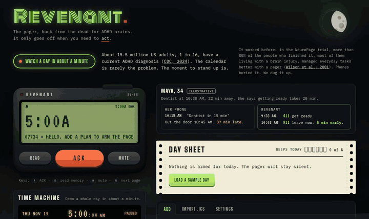
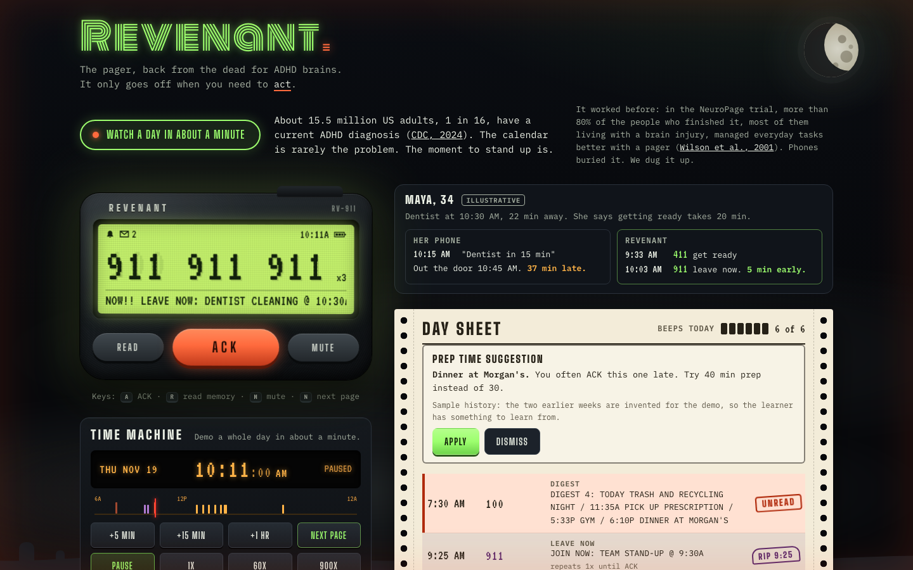
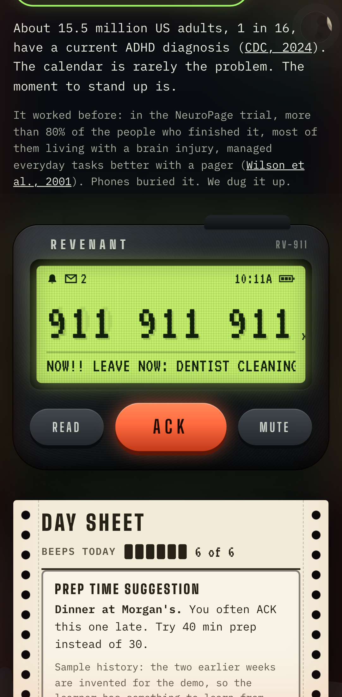
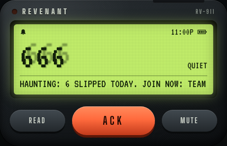
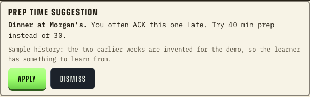
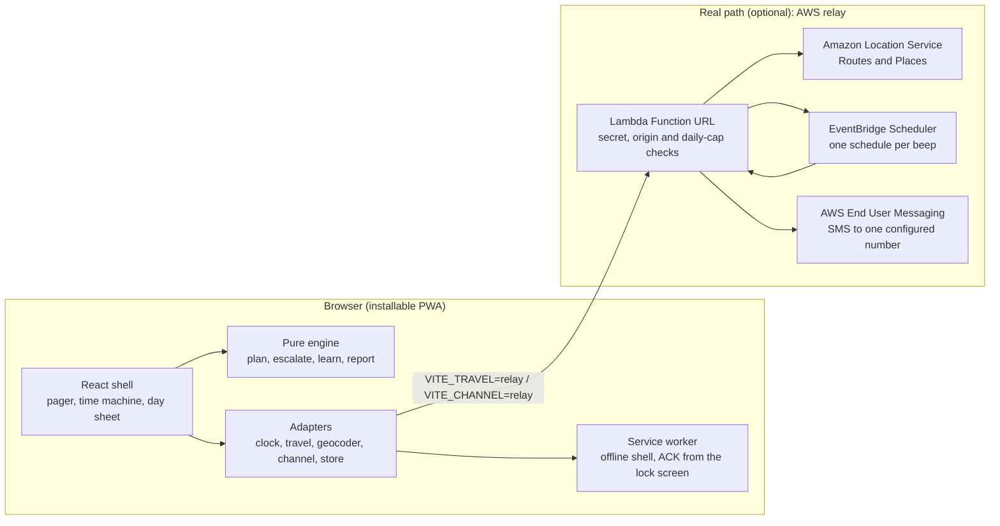

# Revenant

[](https://github.com/blackwingArtisan/revenant/actions/workflows/ci.yml) [](LICENSE)

**The 1990s pager, back from the dead for ADHD brains. It stays silent all day and goes off only at the moment you have to act.**



**Live app** · **Demo video** · **Devpost**: links are added when the entry is submitted. Until then: `npm ci && npm run dev`.

**Try it in 60 seconds.** Press **Watch a day (60 s)**, then press **ACK** (or `A`) each time the pager stops and beeps: six presses in all. The quiet digest and the body-double check-ins show for a moment and carry on by themselves. The day ends on a receipt: *"That was your day: 6 beeps, 4 kept quiet in the digest, 0 missed."*

**Built with Kiro.** The spec, steering, hooks, a scoped agent and MCP live in [`/.kiro`](.kiro); the full record is in [`KIRO-LOG.md`](KIRO-LOG.md).

| Kiro feature | In this repo | Proof |
|---|---|---|
| Spec (EARS) | 10 requirements, 151 acceptance criteria, design with a threat model and five correctness properties, 46 tasks mapped to criteria, and a test that fails if a criterion has no task | [`.kiro/specs/time-blind-paging/`](.kiro/specs/time-blind-paging) |
| Spec, end to end | Kiro wrote the on-call escalation spec (12 requirements, 71 EARS criteria, 21 tasks) and built all 21 tasks: engine, two-pager app, relay guard, docs and 10 browser tests | [`.kiro/specs/on-call-escalation/`](.kiro/specs/on-call-escalation), [sessions B to E](KIRO-LOG.md#sessions) |
| Spec task execution | Kiro built the late-ACK learner and the geocoder from open tasks 25 and 26, and its own test caught a bug it then fixed | [Session A](docs/kiro-sessions/2026-11-19-session-a.md) |
| Steering | product, tech and structure always included; relay rules only when `src/relay/**` is in context (fileMatch); a demo script pulled in by hand (manual) | [`.kiro/steering/`](.kiro/steering) |
| Hooks | 8: a PreToolUse guard that blocks `Date.now` and `Math.random` in the engine (it refused Kiro's own probe write on the record, [session D2](docs/kiro-sessions/2026-11-19-session-d2-guard-probe.md)), tests on save, a paging-rules agent hook, a purity check, a post-task traceability check, checks on stop, code-card sync, demo ready | [`.kiro/hooks/`](.kiro/hooks) |
| Custom agent | `revenant-engine`, limited to the engine, its tests and the spec; it built the escalation engine | [`.kiro/agents/`](.kiro/agents) |
| MCP | AWS Documentation and Context7, version-pinned; Kiro used Context7 to check the axe and reduced-motion APIs before writing the browser tests | [`.kiro/settings/mcp.json`](.kiro/settings/mcp.json), [session E](docs/kiro-sessions/2026-11-22-session-e-browser-tests.md) |

- **Pages at the action, not the start.** `411` when it is time to get ready, `911` when it is time to walk out the door, worked out from travel time, a buffer and an honest prep time.
- **Six beeps a day, not fifty-six.** A hard daily silence budget. Everything else goes into one silent `100` digest.
- **Repeats until you ACK.** `911 911`, then `NOW!!`, and it learns from the pages you answer late.
- **A second line of defence.** Name someone on call, and if you still have not answered your must-go `911` a minute after its last repeat, a second on-screen pager, "SECONDARY ON CALL", pages them with `999`. Off by default, on-screen only: nothing is sent to anyone, and it uses one of your daily beeps.

**Kiroween 2026, category Resurrection.** *What died:* the pager, a device that was trusted because it was almost always silent. *What came back:* its behaviour, not just its look: numeric codes, a strict silence budget, repeats until ACK, and pages you ignore coming back to haunt you as `666`.

<table>
  <tr>
    <td width="50%"></td>
    <td width="22%"></td>
    <td width="28%"><br></td>
  </tr>
</table>

## One morning, before and after
Maya, 34, is an illustrative persona, not a real user. Dentist at 10:30 AM, 22 minutes away; she says getting ready takes 20 minutes. The times below are computed by the engine (`src/engine/compare.ts`, checked in `tests/unit/compare.test.ts`) and shown in the app above the day sheet.

| | What fires | What happens |
|---|---|---|
| **Her phone** | 10:15 AM "Dentist in 15 min" | Getting ready really takes 30 min, so she is out the door at 10:45 and **37 min late**. |
| **Apple time-to-leave** | 10:08 AM "Time to leave" | Right about the drive, but nothing told her to get ready: out at 10:38, **30 min late**. |
| **Revenant** | 9:33 AM `411` get ready, 10:03 AM `911` leave now | She arrives at 10:25, **5 min early**, after two beeps. |

## Why a pager? It worked before
In the 1990s, the NeuroPage trial gave people with memory and planning problems a pager that sent short reminders at the moment to act. In a randomised crossover study of 143 people aged 8 to 83, more than 80% of those who completed the 16 weeks were significantly better at everyday tasks such as taking medication and keeping appointments with the pager, and most kept the gain 7 weeks after handing it back ([Wilson et al., *J Neurol Neurosurg Psychiatry* 70(4), 2001](https://doi.org/10.1136/jnnp.70.4.477)). That trial's participants were mostly people with brain injuries, not ADHD; Revenant borrows the mechanism, not the result. Many hospital teams still carry pagers today: a dedicated device that rarely goes off is hard to ignore.

We didn't invent this. Phones buried it under a median of 56 notifications a day ([Pielot et al., MobileHCI 2018](https://doi.org/10.1145/3229434.3229445)). We dug it up.

**Why it matters**
- **In an adult ADHD clinic, 42% of patients missed three or more appointments** during treatment ([Soendergaard et al., *J Clin Psychiatry* 77(2), 2016](https://doi.org/10.4088/JCP.14m09270)).
- About 15.5 million US adults, 1 in 16, have a current ADHD diagnosis, and more than half were diagnosed as adults ([CDC, *MMWR* 73(40), 2024](https://www.cdc.gov/mmwr/volumes/73/wr/mm7340a1.htm)).
- Adults with ADHD miss GP appointments about twice as often as matched patients (odds ratio 1.9, [McQueenie et al., *PLOS Mental Health*, 2024](https://doi.org/10.1371/journal.pmen.0000045)), and a meta-analysis of 824 effect sizes finds a consistent deficit in time perception ([Metcalfe et al., *Developmental Neuropsychology*, 2024](https://doi.org/10.1080/87565641.2023.2293712)).
- For comparison, the no-show rate across all specialties averages about 23% ([Dantas et al., *Health Policy*, 2018](https://doi.org/10.1016/j.healthpol.2018.02.002)).

Every figure, with what the source actually says, is in [`docs/evidence.md`](docs/evidence.md).

## Why not the tools people already have?
Each of these does one part well. None does the combination, and the combination is the point.

| | Revenant | Apple Calendar time-to-leave | Due | iOS Scheduled Summary | Tiimo |
|---|---|---|---|---|---|
| Fires at the moment to act | Yes: get ready and leave now | Yes: leave now, from traffic | At a time you set | No: it holds notifications back | At a time you set |
| Counts prep with an honesty factor | Yes (x1.5 by default) | No | No | No | Not documented |
| Repeats until you ACK | Yes, then stops when moot | No | Yes (Auto Snooze) | No | Not documented |
| Hard daily beep budget plus a silent digest | Yes | No | No | Digest only, no cap | Not documented |
| Learns from late ACKs | Yes, and only suggests | No | No | No | Not documented |
| Chains travel from the previous appointment | Yes (within 3 hours) | Yes (within 3 hours) | No | No | Not documented |
| No account, any modern browser | Yes | Apple devices | Apple devices | Apple devices | Subscription sign-in |

Based on each maker's own documentation, linked in [`docs/evidence.md`](docs/evidence.md). "Not documented" means the maker's pages do not describe it.

## Beyond Kiroween
- **Free local tier, as it is today.** The pager runs entirely in the browser: no account, no server, nothing leaves the device.
- **Relay tier, about $3-4 a month.** Pages that arrive with the app closed, real road travel times and address lookup, through a small AWS relay. At six pages a day, Web Push costs well under a cent per user per month; SMS to an old phone costs about $2.15 a month in texts (180 x $0.01195, AWS pricing checked 2026-11-19), so it fits better as an add-on. The arithmetic is in [`docs/real-path.md`](docs/real-path.md#cost-shape).
- **Clinics and ADHD coaches.** The no-show problem is the clinic's problem too. A practice or coach can share a calendar (.ics) feed of appointments, and each patient's pager turns it into `411` and `911` pages timed to their own travel and prep. Import of .ics files works today; a subscribed feed is the next step. The payback is simple: a no-show cost a large US medical center an average of $196 in 2008, and a phone reminder call there cut the no-show rate only from 16.3% to 15.8% ([Kheirkhah et al., 2016](https://doi.org/10.1186/s12913-015-1243-z)). At the relay tier's $36-48 a year, one avoided no-show per patient every four years covers it.
- **Market.** 15.5 million US adults with a current ADHD diagnosis at $36 a year is a ceiling of about $560 million a year in the US alone, before clinics and coaches.
- **Why now.** About a third of US adults with ADHD receive no treatment at all, and 71.5% of those taking a stimulant had trouble filling the prescription in the past year ([CDC, 2024](https://www.cdc.gov/mmwr/volumes/73/wr/mm7340a1.htm)). A free, drug-free, private tool for the moment of leaving the house fills a gap they already feel.

## How it works


The engine is pure: each tick the app asks it "given these pages, these ACKs and this instant, what should have beeped?" and delivers only what it has not delivered before. Because the clock is injected, the same code drives the real clock, the 900x demo and every test. Everything defaults to the free local adapters.

**AWS status:** the relay is built, hardened (server-side destination, daily caps, constant-time secret, origin check) and unit-tested against stub AWS clients. It is not deployed yet; see [`docs/real-path.md`](docs/real-path.md).

Every feature, and how each part switches between the free local adapter and the AWS one: [`docs/features.md`](docs/features.md).

## Codes
`411` get ready · `911` leave now · `911 911` still here? · `121` body double · `200` wrap up · `100` digest · `666` missed, and it comes back · `999` secondary on call (off by default, on-screen only) · `07734` hELLO. The full wallet card is in the app and in [`docs/features.md`](docs/features.md#codes).

## Run it
Requires Node 22 or later.

```sh
npm ci
npm run dev        # http://localhost:3150
```

Demo URL switches, the production build and media capture: [`docs/features.md`](docs/features.md#run-and-demo-switches).

## Test it
```sh
npm run check      # TypeScript typecheck + Vitest unit tests
npx playwright install chromium   # once
npm run test:e2e   # Playwright against the production build (desktop + phone)
```

219 unit tests (Vitest, including fast-check properties) and 31 end-to-end tests (Playwright, desktop and Pixel 7), all passing from a clean clone. [`.github/workflows/ci.yml`](.github/workflows/ci.yml) runs the same suites on every push.

What each suite covers, test by test: [`docs/testing.md`](docs/testing.md).

## Credits
Fonts are self-hosted through Fontsource: VT323, Big Shoulders Display, IBM Plex Mono and Monoton under the SIL Open Font License 1.1, and Special Elite under the Apache License 2.0. Runtime: React (MIT). AWS SDK for JavaScript v3 (Apache 2.0) is an optional dependency used only by the relay.

## License
MIT, Stubborn Otter Software. All names, places and phone numbers in the sample data are invented, and Maya is an illustrative persona.
